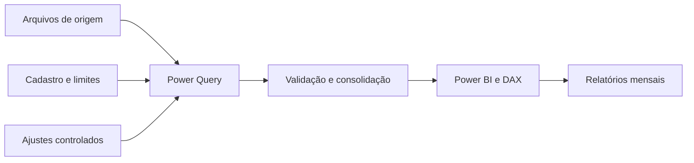
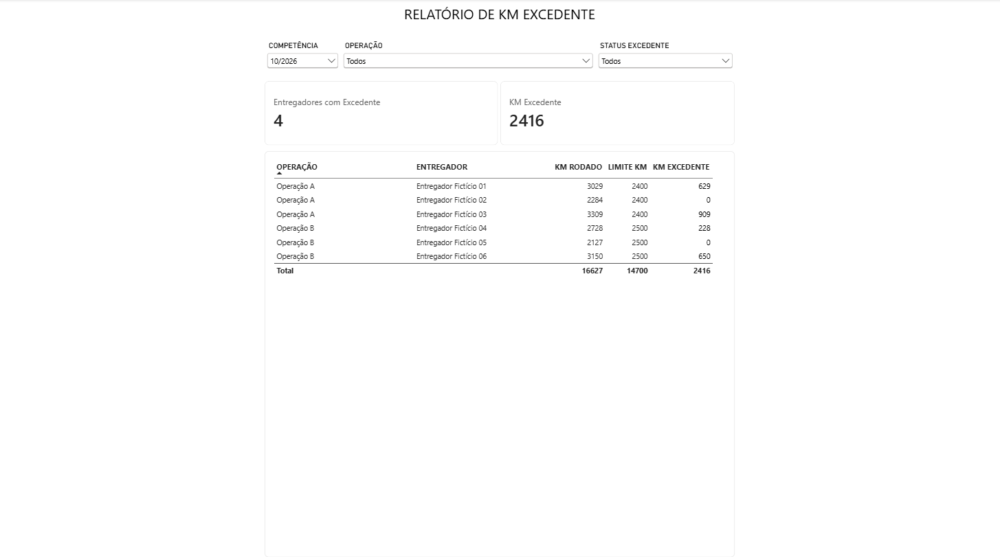
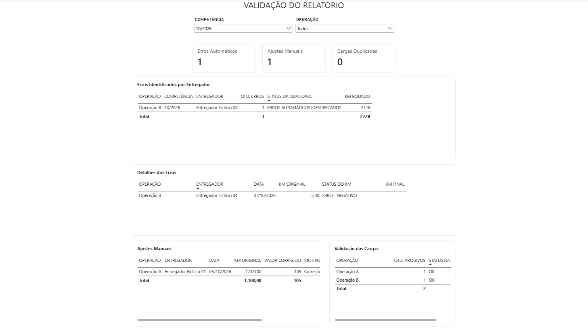
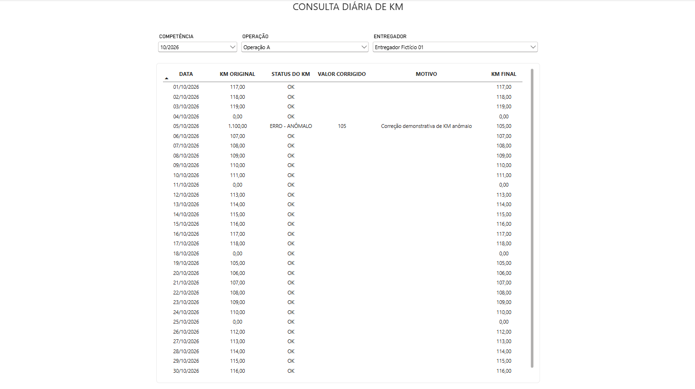
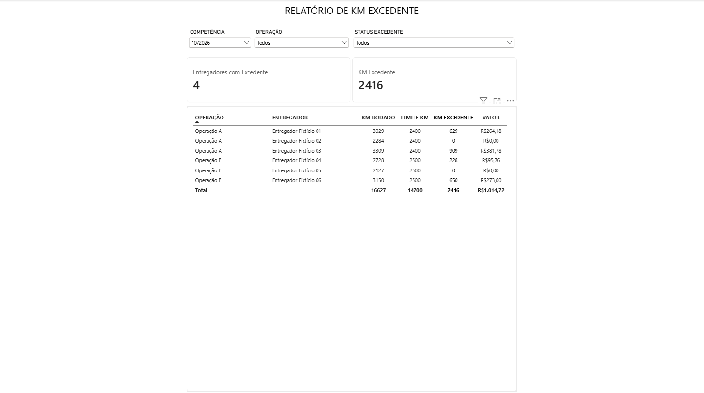

# Relatório de KM Excedente

*Projeto empresarial · Em operação · Em manutenção*

Solução de engenharia e análise de dados desenvolvida para consolidar a quilometragem de entregadores, validar registros e apurar quilômetros excedentes em operações logísticas.

## Contexto empresarial

Desenvolvido durante minha atuação profissional como Analista de Dados em uma empresa do setor de logística.

A solução atende uma demanda operacional recorrente de consolidação, conferência e entrega de relatórios mensais de quilometragem, sendo utilizada no ambiente empresarial.

## Objetivo

Estruturar o processamento de arquivos exportados de um sistema operacional, considerando diferentes operações, competências, limites de quilometragem e inconsistências nos registros.

O projeto busca padronizar o processo mensal, preservar o histórico e garantir a rastreabilidade das informações utilizadas nos relatórios.

## Evolução da solução

| V1 — Excel e Power Query | V2 — Power BI |
| --- | --- |
| Modelos reutilizáveis por operação | Consolidação de múltiplas operações |
| Tratamento e relatórios individuais | Tratamento e análise centralizados |
| Processamento separado por operação | Histórico de múltiplas competências |
| Relatórios individuais | Validação, ajustes controlados e relatórios por cliente |

A primeira versão estabeleceu um processo reutilizável de tratamento de dados.

A segunda ampliou a capacidade de consolidação, validação e análise, centralizando o processo em um modelo de Business Intelligence.

## Fluxo de dados

## Funcionalidades

- Extração e transformação de dados operacionais.
- Consolidação da quilometragem diária por entregador, operação e competência.
- Identificação de registros inválidos e ausência de marcação.
- Controle de duplicidade de carga.
- Preservação dos registros originais.
- Aplicação de ajustes manuais documentados.
- Aplicação de limites de quilometragem por operação.
- Apuração de quilômetros excedentes e valores financeiros.
- Consulta individual de registros diários.
- Exportação de relatórios mensais por cliente.

## Qualidade e rastreabilidade dos dados

O modelo diferencia marcações válidas, registros ausentes e valores inconsistentes.

Os ajustes manuais preservam o valor original, o valor corrigido e o motivo da alteração, permitindo a conferência das informações.

| Registro original | Ajuste | Resultado |
| --- | --- | --- |
| 120 km | — | Marcação válida |
| 0 km | — | Marcação válida |
| Ausente | — | Sem marcação |
| Valor inválido | — | Sinalizado para validação |
| 90 km | 110 km | Valor corrigido com histórico preservado |

Os registros apresentados são fictícios.

## Estrutura do relatório

| Página | Finalidade |
| --- | --- |
| Resumo | Consolidação dos indicadores de quilometragem excedente |
| Validação | Identificação de erros, ajustes e duplicidades |
| Consulta Diária | Conferência individual dos registros |
| Entrega Cliente | Apuração operacional e financeira |
| KM Diário | Matriz de quilometragem por entregador e dia |

## Tecnologias utilizadas

- Microsoft Excel
- Power Query (linguagem M)
- Power BI Desktop
- DAX
- Modelagem de dados
- Processos de ETL

## Resultados e competências

- Padronização do processamento mensal.
- Centralização de informações anteriormente distribuídas.
- Preservação do histórico operacional.
- Rastreabilidade das alterações nos registros.
- Separação entre tratamento, validação e apresentação.
- Desenvolvimento de indicadores operacionais e financeiros.
- Construção de uma solução de Business Intelligence aplicada a demandas empresariais reais.

## Demonstração

### Resumo

### Validação dos dados

### Consulta diária

### Entrega ao cliente

### Relatório de KM diário

### Arquivo demonstrativo

A versão demonstrativa reproduz as principais funcionalidades da V2 utilizando dados fictícios incorporados ao Power Query, sem depender das fontes corporativas originais.

[Baixar relatório demonstrativo — Power BI](KM%20EXCEDENTE%20-%20PORTFOLIO.pbix)

Para explorar o relatório, utilize o Power BI Desktop.

## Confidencialidade

Este repositório possui finalidade demonstrativa e de portfólio profissional.

A solução original foi desenvolvida e utilizada em ambiente empresarial. A versão disponibilizada utiliza registros fictícios e não inclui os documentos operacionais ou as bases de dados corporativas originais.
