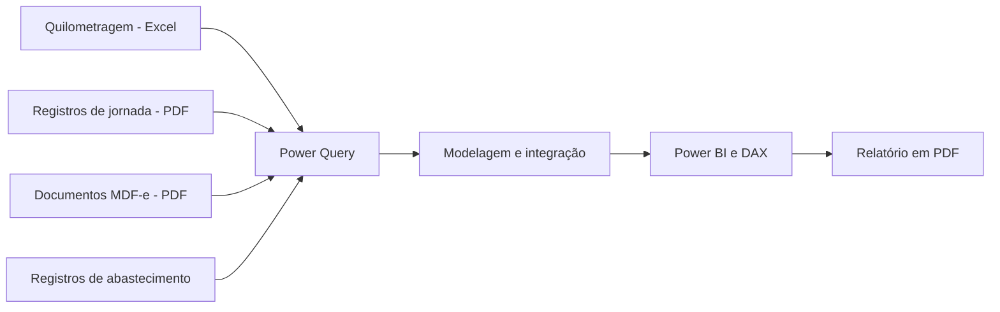
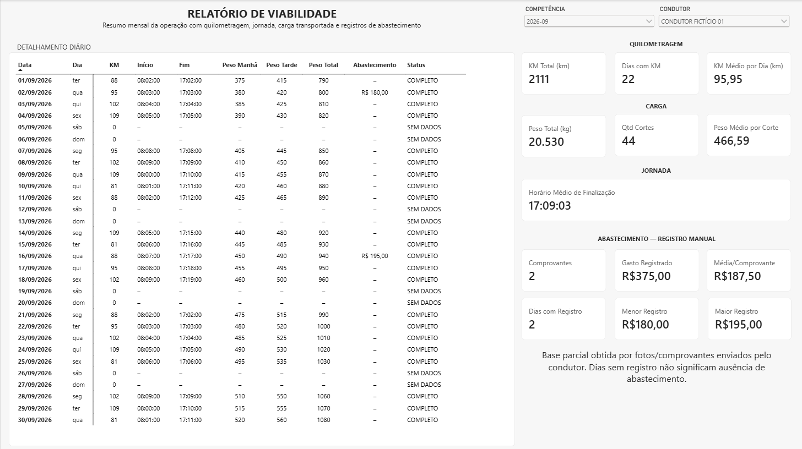
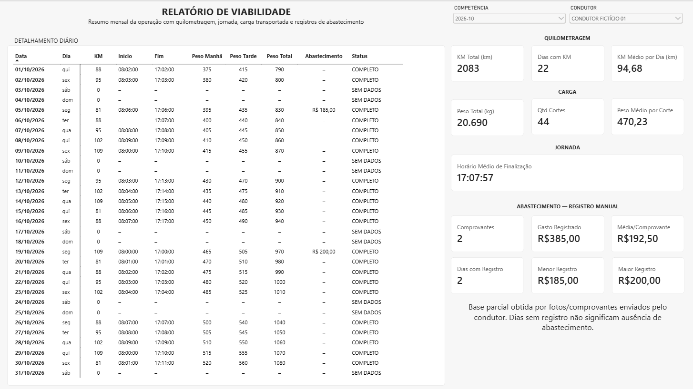

# Relatório de Viabilidade por Condutor

*Projeto empresarial · Concluído*

Solução de análise operacional desenvolvida para integrar diferentes fontes de dados e avaliar individualmente a operação de condutores.

## Contexto empresarial

Desenvolvido durante minha atuação profissional como Analista de Dados em uma empresa do setor de logística.

O projeto surgiu de uma necessidade real de avaliação operacional, considerando informações distribuídas entre sistemas, documentos de transporte e registros manuais.

## Objetivo

Consolidar informações de quilometragem, jornada de trabalho, carga transportada e despesas de abastecimento em um relatório mensal, permitindo uma análise individualizada da operação.

## Fluxo de dados

## Funcionalidades

- Extração de informações de planilhas Excel.
- Extração e tratamento de dados de documentos PDF.
- Integração de registros por condutor e data.
- Padronização de nomes e formatos de dados.
- Consolidação da quilometragem diária.
- Acompanhamento de horários de início e término da jornada.
- Identificação de registros incompletos.
- Apuração do peso transportado por corte operacional.
- Consolidação de despesas de abastecimento.
- Análise individual por condutor e competência.
- Exportação de relatórios mensais em PDF.

## Indicadores

| Categoria | Indicadores |
| --- | --- |
| Quilometragem | KM total, dias com KM e média diária |
| Carga | Peso total, quantidade de cortes e peso médio por corte |
| Jornada | Horário médio de finalização |
| Abastecimento | Quantidade de comprovantes, gastos registrados, média, menor e maior registro |

## Qualidade dos dados e limitações

A solução considera que diferentes fontes podem apresentar níveis distintos de cobertura.

A ausência de uma informação não invalida automaticamente os demais registros disponíveis naquele dia.

Os registros de abastecimento são parciais. A ausência de comprovante não significa ausência de abastecimento.

A integração foi desenvolvida sem utilização de API, utilizando os documentos e registros disponíveis no contexto operacional.

## Tecnologias utilizadas

- Microsoft Excel
- Power Query (linguagem M)
- Power BI Desktop
- DAX
- Extração de dados de documentos PDF
- Modelagem relacional
- Processos de ETL

## Resultados e competências

- Integração de fontes de dados heterogêneas.
- Extração de informações de documentos estruturados e semiestruturados.
- Consolidação de registros operacionais.
- Tratamento de inconsistências e dados ausentes.
- Modelagem de dados e construção de indicadores.
- Análise operacional individualizada.
- Comunicação de resultados por meio de relatórios gerenciais.

## Demonstração

### Setembro de 2026

### Outubro de 2026

### Arquivo demonstrativo

A versão demonstrativa utiliza dados fictícios incorporados ao Power Query, simulando as estruturas das fontes originais e preservando as principais funcionalidades de tratamento e análise.

[Baixar relatório demonstrativo — Power BI](VIABILIDADE%20POR%20CONDUTOR%20-%20PORTFOLIO.pbix)

Para explorar o relatório, utilize o Power BI Desktop.

## Confidencialidade

Este repositório possui finalidade demonstrativa e de portfólio profissional.

A solução original foi desenvolvida em contexto empresarial real. Os arquivos disponibilizados utilizam dados fictícios, sem divulgação de nomes, rotas, custos reais, documentos fiscais ou bases corporativas originais.
